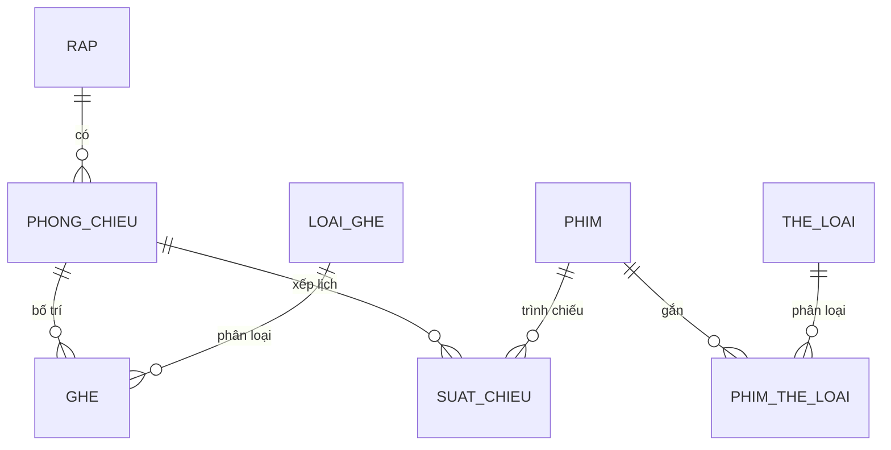
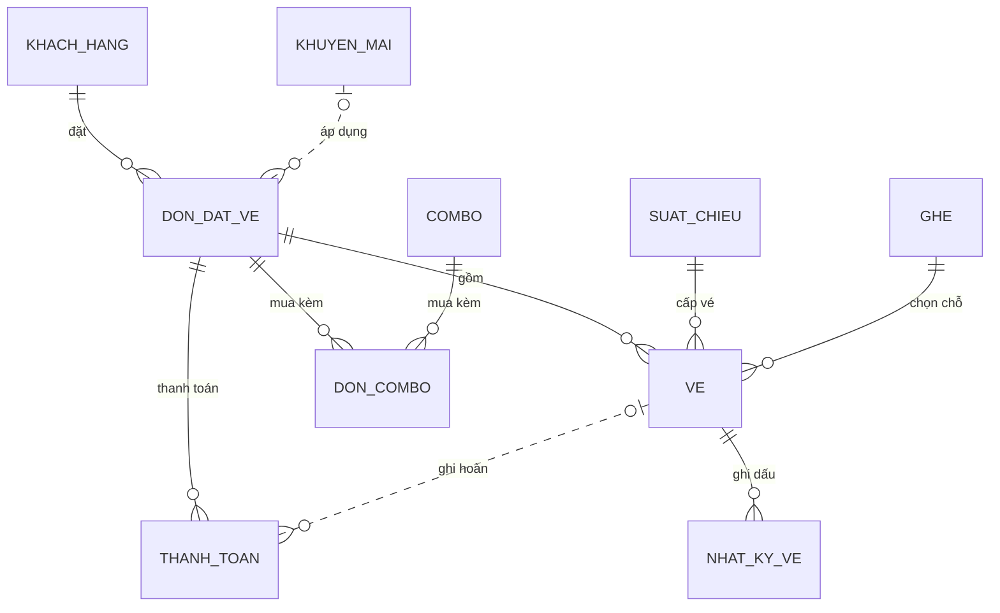

# Galaxy HUFLIT

## Bài toán

Một cụm rạp cần bán vé tại quầy và trực tuyến từ cùng nguồn ghế. Khách chọn suất, giữ ghế trong 10 phút, thanh toán và nhận vé QR. Khi nhiều khách chọn cùng ghế, Oracle chỉ chấp nhận một lượt giữ còn hiệu lực. Hệ thống còn kiểm soát lịch chiếu, voucher, hoàn tiền và trạng thái vé tại cổng.

## Mô hình dữ liệu

Lược đồ gồm đúng 16 bảng. `PHIM_THE_LOAI` xử lý quan hệ nhiều–nhiều; `THE_LOAI` là danh mục phẳng. `COMBO` là danh mục bán, `DON_COMBO` giữ số lượng và đơn giá chốt. Vai trò trình diễn không bổ sung bảng ngoài lược đồ báo cáo.

Các bảng danh mục tách dữ liệu rạp, phòng, loại ghế, phim và khách. Vé tham chiếu khóa thay vì lưu lặp tên phòng hoặc phim. Đơn giữ tổng tiền và tiền giảm; `ve.gia_ve` giữ giá vé tại thời điểm đặt. Hoàn tiền tạo thêm dòng `HOAN_TIEN` trong `THANH_TOAN` và tham chiếu vé tương ứng. `DON_COMBO.ma_combo` tham chiếu `COMBO`, nhưng đơn giá chốt nằm trên dòng mua để thay đổi giá danh mục không sửa lịch sử.

## Ba tình huống kỹ thuật chính

1. **Hai khách cùng chọn một ghế.** `sp_giu_cho` nhận mảng JSON từ API, kiểm tra 1–8 ID nguyên và chèn vé theo thứ tự mã ghế trong giao dịch. Chỉ mục duy nhất chứa hai biểu thức điều kiện cho suất và ghế. Vé hiệu lực có hai khóa khác NULL, vé hủy hoặc hết hạn có hai khóa NULL nên Oracle không đưa vào B-tree. Phiên thứ hai chờ nếu phiên đầu chưa hoàn tất việc chèn cùng khóa. Sau khi phiên đầu COMMIT, phiên sau nhận `ORA-20021` nếu ghế đã giữ hoặc bán.
2. **Lịch chiếu trùng hoặc nghỉ dưới 15 phút.** Một CHECK trên dòng chỉ kiểm tra giờ bắt đầu và kết thúc của chính dòng đó. Compound trigger giữ ID các suất thay đổi và kiểm tra quan hệ với các suất khác ở mức câu lệnh sau khi lấy khóa phòng. Hai phiên cùng xếp lịch cho một phòng được tuần tự hóa. Ca 14 phút và 15 phút minh họa rõ biên.
3. **Voucher hết lượt, thanh toán lặp và hết giờ giữ chỗ.** Thanh toán khóa đơn trước, khóa voucher sau và kiểm tra lại thời hạn cùng hạn mức. Khóa duy nhất `ma_giao_dich_ngoai` chặn giao dịch trùng. Khi thất bại, package lùi về savepoint của thao tác. Job chạy mỗi phút dùng `FOR UPDATE SKIP LOCKED` để xử lý các đơn quá hạn mà không chờ đơn đang khóa.

## Luồng thao tác từ web đến Oracle

| Thao tác | API | Oracle |
|---|---|---|
| Chọn phim, rạp, ngày, suất | `GET /api/catalog`, `GET /api/suat-chieu` | Đọc danh mục và suất sắp chiếu |
| Hiện sơ đồ ghế | `GET /api/suat-chieu/{id}/ghe` | `V_SO_DO_GHE` và `FN_TINH_GIA_VE` |
| Tạm tính và giữ ghế | `POST /api/tinh-tien-tam`, `POST /api/don-dat-ve` | `FN_TINH_GIA_VE`, `FN_TINH_GIAM` và `SP_GIU_CHO` |
| Thanh toán demo | `POST /api/don-dat-ve/{id}/thanh-toan` | `SP_THANH_TOAN` ghi giao dịch, voucher, điểm và QR |
| Kiểm tra QR | `POST /api/soat-ve` | `SP_SOAT_VE` khóa vé và trả kết quả quét |
| Hủy và hoàn | `POST /api/ve/{id}/huy` | `SP_HUY_VE` kiểm tra biên 2 giờ, ghi hoàn và thu hồi điểm |
| Báo cáo | `GET /api/bao-cao/*` | `DENSE_RANK`, `LAG`, `SUM OVER`, recursive CTE và `CONNECT BY` |
| Kiểm thử và đo kế hoạch | `/api/admin/tests/{case}`, `/api/lab/execution-plan` | Hai phiên Oracle, `DBMS_XPLAN.DISPLAY_CURSOR` |

FastAPI xác thực JWT, giới hạn thao tác theo vai trò, kiểm tra quyền sở hữu đơn hoặc phạm vi rạp, bind tham số rồi gọi Oracle. API COMMIT sau khi nghiệp vụ thành công. Khi phát sinh lỗi, kết nối trả về pool với giao dịch chưa commit được rollback. React hiển thị dữ liệu từ phản hồi API và dựng mã QR từ giá trị Oracle cấp.

## Kiểm thử và tối ưu

Trang Kỹ thuật IT có chín ca tự động, gồm giữ ghế, phụ thu, tranh chấp, hết hạn và đặt lại, voucher, mã giao dịch trùng, hủy và hoàn, quét hai lần, kiểm tra trigger. Phần lớn ca chạy trong giao dịch rollback. Ca tranh chấp phải COMMIT ở phiên A để phiên B nhận xung đột, sau đó dọn riêng dữ liệu kiểm thử.

Query A lấy các ghế hiệu lực theo suất. Chỉ mục `IX_VE_SUAT_TT_GHE` chứa cả cột lọc lẫn cột trả về. Query B lấy 10 đơn gần nhất theo khách. `IX_DON_KH_TG` hỗ trợ tìm theo khách và đọc theo thứ tự thời gian, sau đó Oracle truy cập dòng để lấy các cột còn lại. Cả hai chạy cùng biến bind với hint FULL và INDEX, rồi lấy số liệu lần chạy thật bằng `ALLSTATS LAST`. Cách đo giữ nguyên chỉ mục của ứng dụng. Xem `docs/ket-qua-kiem-thu.md` để đối chiếu số đo.

## Kịch bản trình bày 9 phút

| Thời gian | Nội dung |
|---|---|
| 0:00–1:00 | Trình bày bài toán bán cùng một ghế qua nhiều kênh và kiến trúc React → FastAPI → Oracle 23ai |
| 1:00–2:30 | Giải thích lược đồ, các khóa, chỉ mục điều kiện và trạng thái vé |
| 2:30–4:30 | Chọn suất tại rạp Quận 1, giữ hai ghế, nhập GIAM10, thanh toán và mở QR |
| 4:30–5:30 | Chuyển vai trò Soát vé, quét hai lần để xem hai kết quả khác nhau |
| 5:30–7:00 | Chạy TC-03 và TC-09 trong vai trò Kỹ thuật IT |
| 7:00–8:30 | So sánh Query A, B qua buffer thực đo và các operation trong plan |
| 8:30–9:00 | Nêu phạm vi giao dịch demo và mở mã PL/SQL để chuẩn bị vấn đáp |

### Tự luyện vấn đáp

- Vì sao dùng hai biểu thức điều kiện trong chỉ mục duy nhất? Thử giải thích chuyện gì xảy ra nếu chỉ cho cột thứ ba trả NULL.
- Vì sao trigger kiểm tra lịch cần đọc bảng sau câu lệnh? Giải thích tình huống hai người lập lịch đồng thời và tác dụng của khóa phòng.
- Vì sao chỉ giữ khóa ghế trong giao dịch ngắn, còn 10 phút được lưu trong dữ liệu?
- Chỉ ra chỗ kiểm tra voucher ở lúc giữ và lúc thanh toán. Giải thích kết quả nếu hai đơn cùng dùng voucher còn một lượt.
- Chỉ ra nơi API bind tham số, kiểm tra quyền, COMMIT và ánh xạ `ORA-20021` thành HTTP 409.
- Tự chỉnh điều kiện thời hạn giữ chỗ trên một schema demo và cập nhật ca kiểm thử tương ứng.

## Tài liệu kỹ thuật

- [Oracle Database 23ai Free](https://docs.oracle.com/en/database/oracle/oracle-database/23/xeinl/)
- [Oracle PL/SQL Language Reference](https://docs.oracle.com/en/database/oracle/oracle-database/23/lnpls/)
- [Oracle DBMS_XPLAN](https://docs.oracle.com/en/database/oracle/oracle-database/23/arpls/DBMS_XPLAN.html)
- [Python oracledb Thin Pool](https://python-oracledb.readthedocs.io/en/stable/user_guide/connection_handling.html)
